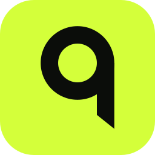

<p align="center">
  
</p>

<h1 align="center">Toque</h1>

<p align="center">Menos retraso en Roblox, con pruebas que lo demuestran.</p>

<p align="center">
  <a href="https://github.com/dimelim/toque/releases/latest"></a>
  <a href="LICENSE"></a>
  
</p>

Toque es una app para Windows que mide el retraso real de Roblox, empezando por Realistic Street Soccer, y solo aplica los cambios que demuestran reducirlo en pruebas A/B dentro del juego. También te deja elegir la ciudad del servidor y entrar en tu servidor privado.

## Funciones

- **Mide tu partida.** FPS, 1 % low, tirones, latencia de render y el ping real dentro del juego.
- **Optimiza con pruebas.** Solo recomienda lo que mejoró en pruebas A/B, y cada cambio se deshace con un clic.
- **Diagnostica qué te frena.** Red tramo a tramo, memoria y disco, cómo dibuja Roblox, Windows y energía.
- **Juega cerca.** Comprueba el servidor al entrar y te mueve si Roblox te mandó lejos.
- **Elige la ciudad.** Los 35 centros de datos de Roblox, incluidos Lima, Santiago, Buenos Aires y Querétaro. Si no hay partidas en esa ciudad, Toque vigila y entra en cuanto aparece una.
- **Entra en tu servidor privado.** Con su enlace de invitación. Eliges en qué ciudad abrirlo y te dice dónde se abrió.
- **Ajusta las flags de Roblox.** Las 18 que Roblox acepta, con controles claros, y listas en JSON de Bloxstrap o Fishstrap con las que Roblox ignora marcadas.

## Descargar

**[Descarga la última versión](https://github.com/dimelim/toque/releases/latest)** y abre `Toque.exe`. Se instala solo y se actualiza por su cuenta con versiones firmadas.

Necesitas Windows 11, permisos de administrador y Roblox instalado.

## Cómo funciona

- **Mide sin tocar el juego.** Lee los eventos de presentación de Windows con Intel PresentMon y el tráfico de Roblox con pktmon.
- **Decide con estadística.** Alterna con y sin cada cambio en orden ABBA y solo da por buena una mejora que se repite y supera la prueba estadística.
- **Lo deja todo como estaba.** Guarda el estado anterior de cada ajuste antes de cambiarlo, así que todo se puede deshacer.

Los detalles técnicos están en [docs/como-funciona.md](docs/como-funciona.md).

## Privacidad

- Nunca lee la cookie de tu cuenta ni toca la memoria del juego, y solo usa las flags que Roblox permite.
- Para saber en qué ciudad está un servidor consulta [ipinfo.io](https://ipinfo.io) y la lista pública de centros de datos de [RoValra](https://github.com/NotValra/RoValra).
- El enlace de tu servidor privado se queda en tu PC.
- Las actualizaciones vienen solo de este repositorio y Toque comprueba su firma antes de instalarlas.

## Compilar desde el código

```powershell
.\build.ps1 -PresentMon C:\ruta\a\PresentMon.exe
```

Necesitas Go 1.27, Node 24, Wails CLI 2.17 y el `PresentMon.exe` de consola de [Intel](https://github.com/GameTechDev/PresentMon/releases). La guía completa está en [CONTRIBUTING.md](CONTRIBUTING.md).

## Contribuir

Las ideas, los avisos de fallos y los pull requests son bienvenidos. Lee [CONTRIBUTING.md](CONTRIBUTING.md) antes de empezar.

## Licencia

[MIT](LICENSE). El software de terceros que incluye conserva su propia licencia, listada en [assets/THIRD-PARTY-NOTICES.txt](assets/THIRD-PARTY-NOTICES.txt). Toque no está afiliado a Roblox Corporation ni a RoValra.
